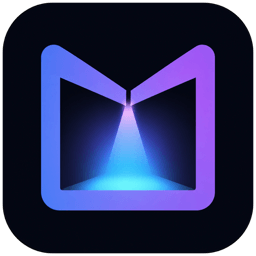
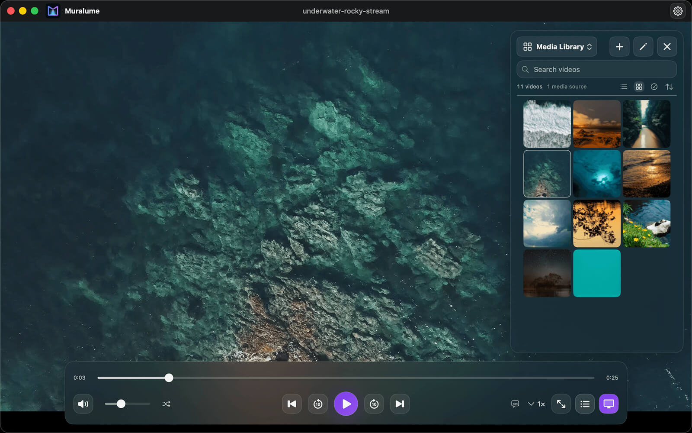

<p align="center">
  
</p>

<h1 align="center">Muralume</h1>

<p align="center"><strong>Your desktop is too big to stand still.</strong></p>

<p align="center">
  <strong>English</strong> · <a href="README.zh-CN.md">简体中文</a>
</p>

<p align="center">
  <a href="https://apps.apple.com/app/id6799577992"><strong>Mac App Store</strong></a>
  ·
  <a href="https://github.com/MisakiHCL/Muralume/releases/latest"><strong>GitHub Release</strong></a>
  ·
  <a href="https://hclgame.com/muralume"><strong>Website</strong></a>
  <br>
  Free · Native Mac app · Apple silicon · macOS 14+
</p>

<p align="center">
  
</p>

Muralume is a small, native Mac app that turns the videos you love into live
wallpapers. They play behind your files and widgets, with a different view on
each display if you like. Your videos stay on your Mac. Muralume has no accounts,
ads, or trackers, and never sends crash reports automatically.

## See it in motion

This short tour shows how a local video becomes a Dynamic Desktop while files,
widgets, and normal desktop interaction remain available.

https://github.com/user-attachments/assets/9a6f92f6-ec13-476c-a863-55134aa03f3a

## Features

### Interactive wallpapers

With Interactive Water, moving the pointer sends ripples through the
picture. A click sends a larger wave. Other effects let you magnify a detail,
light up shadows, pick out a color, or drag a selection to hold part of a frame
while the rest keeps playing. Desktop icons still respond to clicks and drags.

Displays can share a queue or loop different videos. When they play in sync,
the menu bar lets you switch between your library and playlists. With Smart
Pause, playback can pause when the desktop is hidden or Low Power Mode is on,
and resume when those conditions clear.

### Library and play queue

Muralume has read-only access to the videos and folders you choose. It picks
up folder changes while open and shows each source’s last successful refresh
for the session. Browse by list or thumbnail, search by name or location, and
build playlists from your library or Finder. Playlists keep access to their
videos even after you remove a source from the library.

Play in order, shuffle, or loop a single video. The queue shows what’s coming
up and lets you move a video to the front or take it out of the queue. An
optional crossfade eases the transition between videos. Unfinished videos
remember your place. Launch at Login can restore your desktop after sign-in.

### Playback and still frames

Translucent controls tuck away while you watch. Holding the video switches
playback to 2× until you let go. You can switch audio and subtitle tracks, load
SRT or WebVTT subtitles, and adjust their appearance.

Save a frame as a JPEG with its original orientation and aspect ratio. The
player lets you open recent shots from this session or reveal them in Finder.
Video Information shows the file location, resolution, codecs, and tracks.

The app follows your system language or lets you choose English, Simplified or
Traditional Chinese, Japanese, Korean, French, German, Spanish, Brazilian
Portuguese, or Italian.

## Get started

1. Choose **Add Media…** or drag videos and folders from Finder.
2. Browse or search the Media Library, then play a video or organize it into a
   named playlist.
3. Choose ordered playback, shuffle, or Repeat Current Video from the player.
4. Press `⌘D` to use the current playback collection as a Dynamic Desktop, or
   press `⇧⌘D` to customize displays.

## Download

Muralume is free through both official channels, with the same core features:

- [**Mac App Store**](https://apps.apple.com/app/id6799577992) — install from the
  store and receive updates through the App Store.
- [**GitHub Release**](https://github.com/MisakiHCL/Muralume/releases/latest) —
  [download the notarized `Muralume.dmg`](https://github.com/MisakiHCL/Muralume/releases/latest/download/Muralume.dmg)
  directly. Version notes and checksums are published with each
  [GitHub Release](https://github.com/MisakiHCL/Muralume/releases).

For the GitHub version, open the DMG and drag Muralume into Applications.

## Keyboard shortcuts

| Action | Shortcut |
|---|---|
| Add videos or folders | `⌘O` |
| Search videos | `⌘F` |
| Save current video frame as JPEG | `⇧⌘S` |
| Set as Dynamic Desktop / return to the player from the desktop menu | `⌘D` |
| Customize display layout | `⇧⌘D` |
| Play / pause | `Space` |
| Back / forward 10 seconds | `←` / `→` |
| Previous / next video | `↑` / `↓` |
| Mute / unmute | `M` |
| Enter / exit fullscreen | `F` |
| Open settings | `⌘,` |

## System requirements

- Apple silicon Mac
- macOS 14 or later
- A video in an AVFoundation-compatible format, including MP4, MOV, M4V, MPEG,
  MPEG-TS, 3GP, 3G2, AVI, DV, F4V, VOB, MOD, TOD, M2P, MP2V, MPV, MPEG4,
  MPG4, DivX, and Xvid filename variants

Containers and filename variants do not guarantee a particular codec. Playback
compatibility still depends on the codecs available through macOS.

## Build from source

Install Xcode 26.0.1 or later with Swift 6.2 or later and
[ripgrep](https://github.com/BurntSushi/ripgrep), then run:

```bash
git clone https://github.com/MisakiHCL/Muralume.git
cd Muralume
make test
make package-macos
```

`make package-macos` creates a local, ad-hoc signed DMG for development and
installation testing. It is not an official distribution build.

## Open source

Source code is available under the [MIT License](LICENSE). Before contributing,
read [Contributing](CONTRIBUTING.md), the [Security Policy](SECURITY.md), and the
[Community Code of Conduct](CODE_OF_CONDUCT.md). Vendored build components retain
their licenses in [Third-Party Notices](THIRD_PARTY_NOTICES.md). The Muralume
name and visual assets are excluded from the MIT grant; see the
[Brand Assets Notice](BRAND_ASSETS.md).
