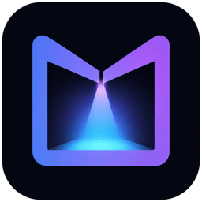
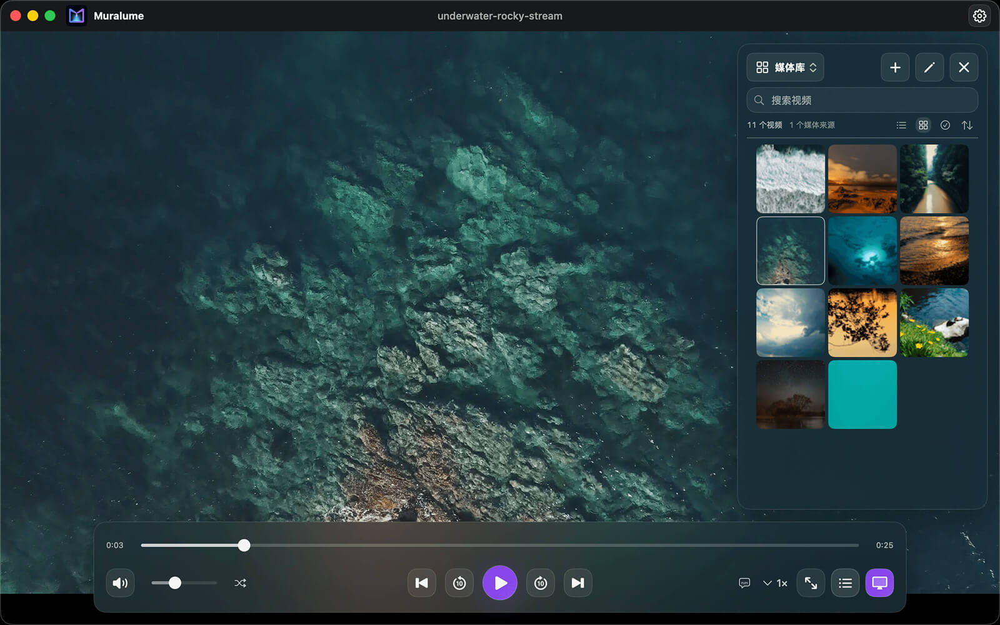

<p align="center">
  
</p>

<h1 align="center">Muralume</h1>

<p align="center"><strong>别让喜欢的影像，只在播放器里出现。</strong></p>

<p align="center">
  <a href="README.md">English</a> · <strong>简体中文</strong>
</p>

<p align="center">
  <a href="https://apps.apple.com/app/id6799577992"><strong>Mac App Store</strong></a>
  ·
  <a href="https://github.com/MisakiHCL/Muralume/releases/latest"><strong>GitHub Release</strong></a>
  <br>
  免费 · 原生 Mac 应用 · Apple 芯片 · macOS 14+
</p>

<p align="center">
  
</p>

Muralume 把宠物、旅途、延时摄影和每一段舍不得关掉的视频，送到每天都在看的
桌面上。小巧的体积里，放进了原生播放、精致的半透明界面和可搜索的媒体库。
画面在文件和小组件后方流动，多块屏幕可以同步播放，也可以各自循环喜欢的视频。
免费使用，视频留在 Mac：无需账号，不上传视频，也没有广告或追踪。

## 看看实际效果

这段简短演示展示了如何把本地视频设为动态桌面，同时保留桌面文件、小组件与
正常交互。

https://github.com/user-attachments/assets/9a6f92f6-ec13-476c-a863-55134aa03f3a

## 功能

本页介绍当前源码中的功能。各正式版本的实际范围以
[GitHub Releases](https://github.com/MisakiHCL/Muralume/releases) 为准。

- **轻巧的体积：** 应用本体小巧，可以直接使用你已有的视频和文件夹。
- **原生视频播放：** 采用 macOS 原生视频框架 AVFoundation，播放本地视频，
  并支持在不同显示器上独立、无缝循环。
- **精致的 Mac 界面：** 半透明播放控制栏与可搜索的媒体库，搭配统一的圆角、图标和间距，
  让视频画面始终是主角。
- **使用熟悉的语言：** 支持英文、简体与繁体中文、日语、韩语、法语、德语、西班牙语、
  巴西葡萄牙语和意大利语，可跟随系统，也可在设置中立即切换。
- **一台 Mac，每块屏幕都精彩：** 将视频放在桌面文件与小组件后方；多块显示器可以同步播放同一组内容，
  也可以分别无缝循环不同视频。
- **桌面看不见时智能暂停：** 可选的“智能暂停”会根据桌面可见性，以及你选择的电源或
  系统状态暂停动态桌面，同时尊重手动播放意图。
- **你的影像，不是平台的内容：** 添加单个视频、文件夹或两者的组合。源文件始终保留在原处，
  Muralume 只访问你主动选择的内容。
- **更多熟悉格式，依然只读：** 除 macOS 常规视频容器外，还可识别常见的 F4V、VOB、
  MOD、TOD、M2P、MP2V、MPV、MPEG4、MPG4、DivX 与 Xvid 文件名变体，无需重命名
  或转换源文件。
- **会自己跟上变化的媒体库：** 切换列表或缩略图网格并记住布局偏好、排序内容、按名称或位置搜索，
  在应用运行期间自动发现已授权文件夹中的变化。
- **来源状态看得清：** 查看各来源状态与本次运行中最近成功刷新的时间；扫描不完整时可重试，
  访问遇到问题时可重新选择来源授权。
- **播放列表由你定义：** 创建自定义分组，多选视频批量加入、批量移除列表条目、调整顺序，在播放列表内搜索，并在
  重新打开应用后继续使用上次的播放列表。移除媒体库来源后，播放列表仍保留对原始本地文件的访问。
- **下一段是什么，一目了然：** 支持顺序播放、随机播放、循环当前视频、进度跳转、音量、
  倍速、全屏，以及独立呈现真实顺序的播放队列。还可开启短交叉淡入，在下一段首帧
  准备好后平滑切换。
- **想听哪条、想看哪条，由你选择：** 可切换视频内嵌音轨与字幕，载入本地 SRT 或
  WebVTT 字幕，并调整字幕大小和外观。
- **只在需要时临时加速：** 按住视频即可临时以 2 倍速播放，松开后回到原先选择的倍速。
- **留下画面，而不是播放器：** 从“操作”菜单或按 `⇧⌘S`，即可将当前视频帧保存为
  体积更小的 JPEG；截图会保留视频方向和宽高比，不包含播放器控件或黑边。视频信息
  面板还可选择复制完整文件路径，查看文件大小及已知的格式、编解码器、分辨率、帧率、色彩、
  音轨与字幕等详情。
- **真正的私密：** 本地处理、只读媒体访问，无账号、上传、产品遥测或自动崩溃上报。
- **离开再回来，精彩继续：** 每个视频都会分别记住尚未接近结尾的播放位置。重新打开
  Muralume 后可恢复当前会话；启用“登录时启动”后，也可在登录系统时恢复动态桌面。

## 开始使用

1. 选择“添加媒体…”，或从访达拖入视频和文件夹。
2. 浏览或搜索媒体库，直接播放视频，或将其整理到自定义播放列表。
3. 在播放器中选择顺序播放、随机播放或循环当前视频。
4. 按 `⌘D` 将当前播放内容设为动态桌面，或按 `⇧⌘D` 自定义显示器。

## 下载

Muralume 通过两个官方渠道免费提供，核心功能一致：

- [**Mac App Store**](https://apps.apple.com/app/id6799577992)：通过商店安装，
  后续更新由 App Store 管理。
- [**GitHub Release**](https://github.com/MisakiHCL/Muralume/releases/latest)：直接
  [下载经过公证的 `Muralume.dmg`](https://github.com/MisakiHCL/Muralume/releases/latest/download/Muralume.dmg)。
  每个版本的正式说明与校验文件统一发布在
  [GitHub Releases](https://github.com/MisakiHCL/Muralume/releases) 页面。

使用 GitHub 版本时，打开 DMG 后将 Muralume 拖入“应用程序”文件夹即可。

## 快捷键

| 操作 | 快捷键 |
|---|---|
| 添加视频或文件夹 | `⌘O` |
| 搜索视频 | `⌘F` |
| 将当前视频帧保存为 JPEG | `⇧⌘S` |
| 设为动态桌面 | `⌘D` |
| 自定义显示器布局 | `⇧⌘D` |
| 播放 / 暂停 | `Space` |
| 后退 / 前进 10 秒 | `←` / `→` |
| 上一个视频 / 下一个视频 | `↑` / `↓` |
| 静音 / 取消静音 | `M` |
| 进入 / 退出全屏 | `F` |
| 打开设置 | `⌘,` |

## 系统要求

- 搭载 Apple 芯片的 Mac
- macOS 14 或更高版本
- AVFoundation 支持的视频格式，包括 MP4、MOV、M4V、MPEG、MPEG-TS、3GP、
  3G2、AVI、DV，以及 F4V、VOB、MOD、TOD、M2P、MP2V、MPV、MPEG4、MPG4、
  DivX 和 Xvid 文件名变体

容器和文件名变体不代表一定支持其中的编解码器；实际播放能力仍取决于 macOS
提供的编解码器。

## 从源码构建

安装 Xcode 26.0.1 或更高版本（Swift 6.2 或更高版本）与
[ripgrep](https://github.com/BurntSushi/ripgrep)，然后运行：

```bash
git clone https://github.com/MisakiHCL/Muralume.git
cd Muralume
make test
make package-macos
```

`make package-macos` 会生成供开发与本机安装测试使用的 ad-hoc 签名 DMG，
它不是正式分发版本。

## 开源

源代码使用 [MIT License](LICENSE)。参与项目前请阅读[贡献指南](CONTRIBUTING.md)、
[安全政策](SECURITY.md)与[社区行为规范](CODE_OF_CONDUCT.md)。构建工具中随仓库提供的
第三方组件保留各自许可，详见[第三方声明](THIRD_PARTY_NOTICES.md)。Muralume 名称与
视觉资产不包含在 MIT 授权范围内，详见[品牌资产声明](BRAND_ASSETS.md)。
