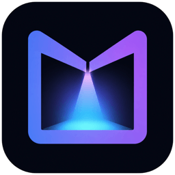
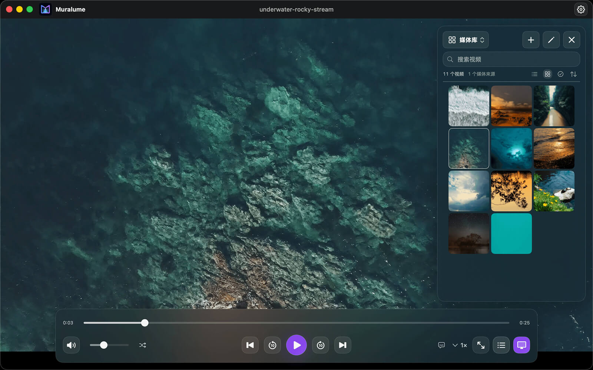

<p align="center">
  
</p>

<h1 align="center">Muralume</h1>

<p align="center"><strong>别让喜欢的影像，只在播放器里出现。</strong></p>

<p align="center">
  <a href="README.md">English</a> · <strong>简体中文</strong>
</p>

<p align="center">
  <a href="https://apps.apple.com/app/id6799577992"><strong>Mac App Store</strong></a>
  ·
  <a href="https://github.com/MisakiHCL/Muralume/releases/latest"><strong>GitHub Release</strong></a>
  ·
  <a href="https://hclgame.com/muralume"><strong>官网</strong></a>
  <br>
  免费 · 原生 Mac 应用 · Apple 芯片 · macOS 14+
</p>

<p align="center">
  
</p>

Muralume 是一款轻巧的 Mac 原生应用，能把喜欢的视频变成动态桌面。视频在文件和小组件后方播放，
每块屏幕都可以有自己的风景。视频留在本机，无需账号，没有广告或追踪，也不会自动发送崩溃报告。

## 看看实际效果

这段简短演示展示了如何把本地视频设为动态桌面，同时保留桌面文件、小组件与
正常交互。

https://github.com/user-attachments/assets/9a6f92f6-ec13-476c-a863-55134aa03f3a

## 功能

### 桌面互动

在「互动水面」里，指针划过画面便泛起涟漪，轻点一下就漾开更大的波纹。
其他效果可以放大指针下的细节、照亮暗处、突出一种颜色，或在框选处留住一帧，让其余画面继续播放。
桌面图标仍可照常点选和拖动。

多块屏幕可以同步播放同一组视频，也可以各自循环一段。同步播放时，从菜单栏就能切换媒体库和播放列表。
智能暂停可在桌面被遮住或 Mac 进入低电量模式时暂停播放，条件解除后继续。

### 媒体库与播放队列

Muralume 只读访问你选定的视频和文件夹。运行时会自动发现文件夹的变化，也会显示各来源最近一次成功刷新的时间。
你可以在列表或缩略图中浏览，按名称或位置搜索，把媒体库或访达里的视频收进播放列表。即使从媒体库移除来源，
播放列表里的视频仍可访问。

按顺序看、随机播放，或单独循环一段。播放队列里可以把想看的视频排到下一段，也可以移除待播视频。
切换时可选淡入淡出。没看完的视频可以接着看，启用「登录时启动」还可在登录后恢复动态桌面。

### 播放与截图

收起半透明控制栏即可专心看视频，按住画面可临时以 2 倍速播放。音轨和字幕都能切换，
也支持载入本地 SRT 或 WebVTT 字幕，自选样式。

喜欢的画面可以单独存为 JPEG，保留视频的方向和宽高比。从播放器即可打开本次保存的最近截图，
也可以在访达中找到它们。视频信息中还可查看文件位置、分辨率、编解码器和音轨等详情。

界面可跟随系统语言，也支持手动选择简体或繁体中文、英语、日语、韩语、法语、德语、
西班牙语、巴西葡萄牙语和意大利语。

## 开始使用

1. 选择“添加媒体…”，或从访达拖入视频和文件夹。
2. 浏览或搜索媒体库，直接播放视频，或将其整理到自定义播放列表。
3. 在播放器中选择顺序播放、随机播放或循环当前视频。
4. 按 `⌘D` 将当前播放内容设为动态桌面，或按 `⇧⌘D` 自定义显示器。

## 下载

Muralume 通过两个官方渠道免费提供，核心功能一致：

- [**Mac App Store**](https://apps.apple.com/app/id6799577992)：通过商店安装，
  后续更新由 App Store 管理。
- [**GitHub Release**](https://github.com/MisakiHCL/Muralume/releases/latest)：直接
  [下载经过公证的 `Muralume.dmg`](https://github.com/MisakiHCL/Muralume/releases/latest/download/Muralume.dmg)。
  每个版本的正式说明与校验文件统一发布在
  [GitHub Releases](https://github.com/MisakiHCL/Muralume/releases) 页面。

使用 GitHub 版本时，打开 DMG 后将 Muralume 拖入“应用程序”文件夹即可。

## 快捷键

| 操作 | 快捷键 |
|---|---|
| 添加视频或文件夹 | `⌘O` |
| 搜索视频 | `⌘F` |
| 将当前视频帧保存为 JPEG | `⇧⌘S` |
| 设为动态桌面 / 从桌面菜单返回播放器 | `⌘D` |
| 自定义显示器布局 | `⇧⌘D` |
| 播放 / 暂停 | `Space` |
| 后退 / 前进 10 秒 | `←` / `→` |
| 上一个视频 / 下一个视频 | `↑` / `↓` |
| 静音 / 取消静音 | `M` |
| 进入 / 退出全屏 | `F` |
| 打开设置 | `⌘,` |

## 系统要求

- 搭载 Apple 芯片的 Mac
- macOS 14 或更高版本
- AVFoundation 支持的视频格式，包括 MP4、MOV、M4V、MPEG、MPEG-TS、3GP、
  3G2、AVI、DV，以及 F4V、VOB、MOD、TOD、M2P、MP2V、MPV、MPEG4、MPG4、
  DivX 和 Xvid 文件名变体

容器和文件名变体不代表一定支持其中的编解码器；实际播放能力仍取决于 macOS
提供的编解码器。

## 从源码构建

安装 Xcode 26.0.1 或更高版本（Swift 6.2 或更高版本）与
[ripgrep](https://github.com/BurntSushi/ripgrep)，然后运行：

```bash
git clone https://github.com/MisakiHCL/Muralume.git
cd Muralume
make test
make package-macos
```

`make package-macos` 会生成供开发与本机安装测试使用的 ad-hoc 签名 DMG，
它不是正式分发版本。

## 开源

源代码使用 [MIT License](LICENSE)。参与项目前请阅读[贡献指南](CONTRIBUTING.md)、
[安全政策](SECURITY.md)与[社区行为规范](CODE_OF_CONDUCT.md)。构建工具中随仓库提供的
第三方组件保留各自许可，详见[第三方声明](THIRD_PARTY_NOTICES.md)。Muralume 名称与
视觉资产不包含在 MIT 授权范围内，详见[品牌资产声明](BRAND_ASSETS.md)。
